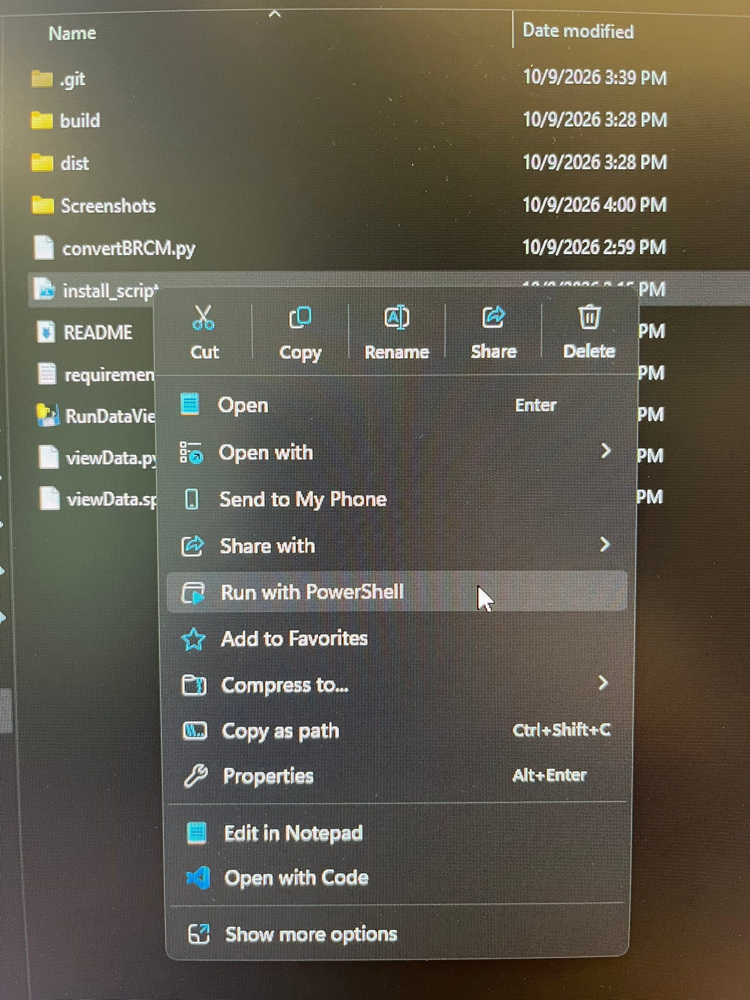

# Install instructions

## Step 1 : Download CVG Dataset from box
- The provided link is found [here](https://app.box.com/folder/422209902625)

## Step 2 : Download the Github Repository 
- The link to the Github repository can be found [here](https://github.com/UTSW-Achilefu-Lab/CVG_Data_Viewer)
- Click on the `<> Code` dropdown menu that's circled in red in the screen shot below
  - Select `Download zip`
  - Save zip file where ever you wish
  - Unzip the folder 

## Step 3 : Run the installation script
- Right click on the `install_script` icon
- Then select `Run with Powershell`

---

# Running the CVG Data Viewer Program 
- Double click on `RunDataViewer`
  - Then select the directory/folder you placed the downloaded CVG images 

---

# Overview of CVG Data Viewer Controls 

| Cycle through images  | Toggle Between Viewing DCM/BRCM files | Quit Program | 
| -------- | :--------: | :--------: |
| Left and Right arrow key(s)   | D   |  Q | 